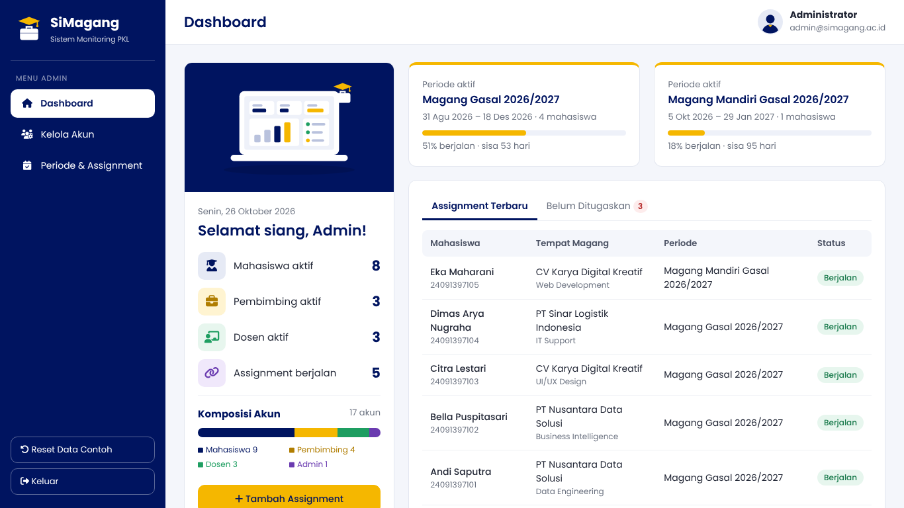
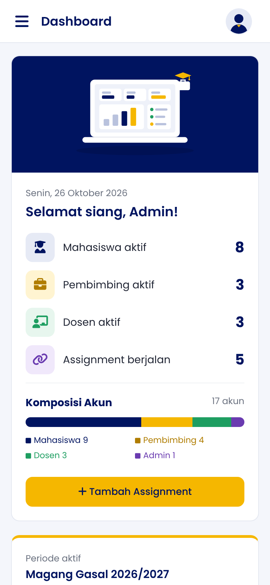
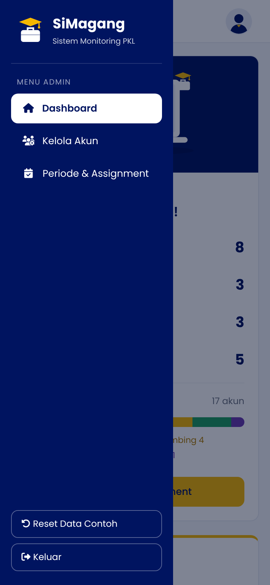
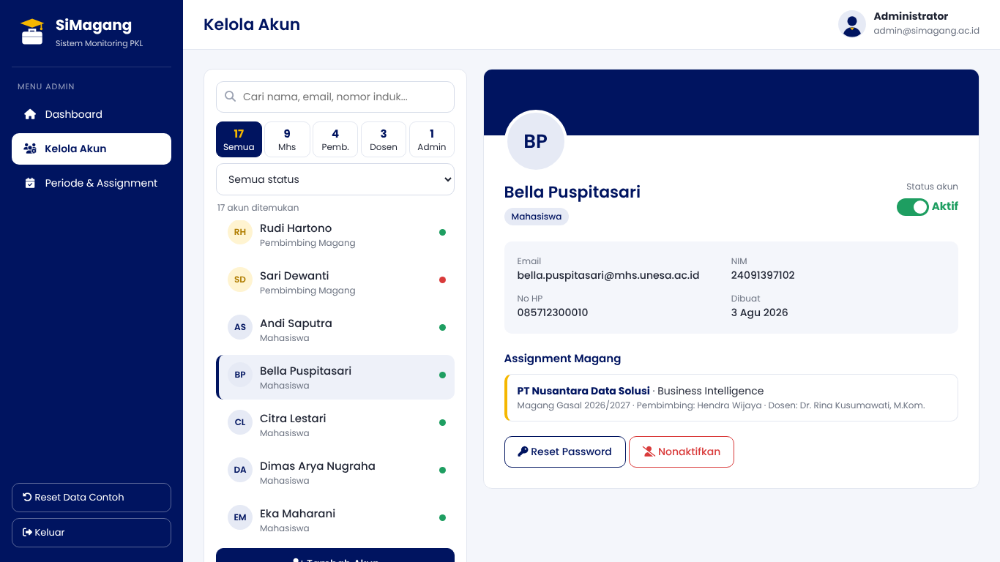
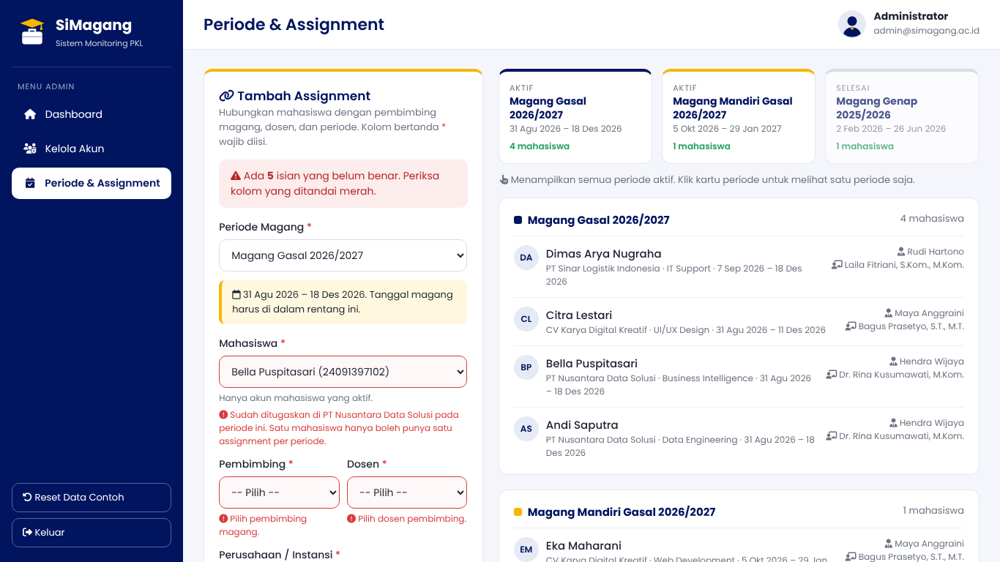
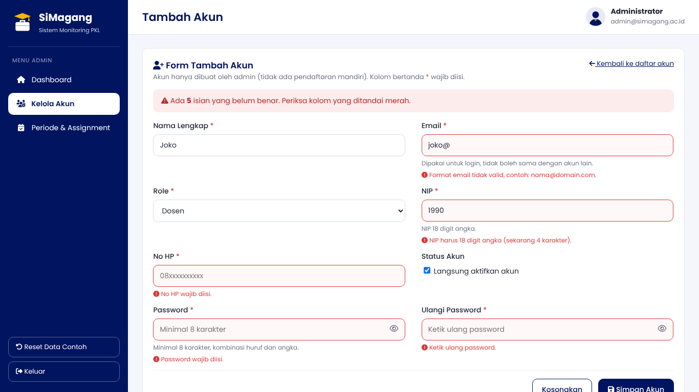

# PWUTS_A10_25091397004 — SiMagang: Modul Admin

Tugas UTS Pemrograman Web: website **Sistem Monitoring Praktik Kerja Lapang (PKL) Mahasiswa**, bagian **Admin**.

| | |
|---|---|
| Nama | Fadhillah Muhammad Nur Hafiz |
| NIM | 25091397004 |
| Kelas | 2025A |
| Kelompok | A10 (Kelompok 10) |
| Program Studi | D4 Manajemen Informatika, Fakultas Vokasi |

### Pembagian modul kelompok

Setiap anggota mengerjakan peran yang berbeda sesuai SRS, jadi halaman 2.a, 2.b, dan 2.c tidak ada yang sama.

| Anggota | NIM | Modul / Peran |
|---|---|---|
| Fadhillah Muhammad Nur Hafiz | 25091397004 | **Admin** (kelola akun, periode, assignment) |
| Rafif Edyna Zada Ramadhan | 25091397026 | Dosen |
| Ashilah Zahirah Haq | 25091397033 | Mahasiswa |

---

## 1. Gambaran Modul Admin

Di SRS (Bab 2.1.5), Admin bertugas mengelola data dasar sistem:

| Kode | Fungsi | Halaman |
|---|---|---|
| F-21 | Kelola akun: tambah, ubah status aktif/nonaktif, reset password | Kelola Akun, Tambah Akun |
| F-22 | Kelola periode magang | Periode & Assignment |
| F-23 | Kelola assignment: hubungkan mahasiswa dengan pembimbing, dosen, dan periode | Periode & Assignment |
| F-24 | Pantau data: ringkasan seluruh data magang | Dashboard |

Tampilan mengikuti **Panduan Gaya Visual SRS (Bab 6.1)**: warna navy `#001460` dan putih, font Poppins, tombol primer biru dan sekunder putih bergaris biru, sudut membulat 8–12 px, sidebar navy di kiri sesuai wireframe.

---

## 2. Cara Menjalankan

Website memakai **Ajax**, jadi **harus dibuka lewat server HTTP**, tidak bisa dengan dobel-klik `index.html`.

Dikembangkan dan diuji dengan **Laragon** (web server **Apache**).

1. Salin folder `PWUTS_A10_25091397004` ke `C:\laragon\www\`.
2. Buka **Laragon**, pastikan web server yang dipakai **Apache** (Menu → Apache), lalu klik **Start All**.
3. Buka browser lalu akses `http://localhost/PWUTS_A10_25091397004/`
   atau alamat virtual host otomatis Laragon: `http://pwuts_a10_25091397004.test/`

> Gunakan **Apache**, bukan Nginx. Nginx menolak request `POST` ke file statis (`server/simpan.json`) dengan error 405, sehingga submit form akan gagal.
> Bisa juga dijalankan di XAMPP: salin ke `C:\xampp\htdocs\` lalu jalankan Apache.

Tidak perlu MySQL atau internet. Semua library (jQuery, Font Awesome, font Poppins) sudah disimpan lokal.

---

## 3. Struktur Folder

```
PWUTS_A10_25091397004/
├── index.html                  ← 2.a  layout utama (homepage)
├── css/
│   └── style.css               ← satu External Style Sheet untuk semua halaman
├── js/
│   ├── jquery-3.7.1.min.js     ← library jQuery
│   ├── data.js                 ← pengambil data (Ajax JSON) + penyimpanan localStorage + fungsi bantu
│   ├── main.js                 ← navigasi menu dengan Ajax, menu HP
│   ├── dashboard.js            ← isi dashboard
│   ├── kelola-akun.js          ← 2.b  halaman interaktif
│   ├── tambah-akun.js          ← 2.c  form tambah akun + validasi
│   └── periode-assignment.js   ← 2.c  form tambah assignment + validasi
├── pages/                      ← potongan halaman yang dimuat ke index.html dengan Ajax
│   ├── dashboard.html
│   ├── kelola-akun.html
│   ├── tambah-akun.html
│   └── periode-assignment.html
├── data/                       ← data contoh, kolom sama dengan struktur tabel di proposal
│   ├── users.json
│   ├── periode.json
│   └── magang.json
├── server/
│   └── simpan.json             ← alamat tujuan submit form (respon server)
├── img/                        ← logo SiMagang, avatar, ilustrasi dashboard (SVG buatan sendiri)
├── vendor/                     ← Font Awesome 6.5.2 & font Poppins (lokal)
├── screenshot/                 ← tangkapan layar untuk README ini
└── README.md
```

---

## 4. Penjelasan Pengerjaan

### 2.a — Homepage `index.html` (layout utama, responsive, navigasi Ajax)



**Layout.** Terdiri dari sidebar navigasi (`<aside>` + `<nav>`), header (`<header>`), area konten (`<main id="konten">`), dan footer (`<footer>`). Semuanya memakai elemen semantik HTML5. Sidebar diletakkan dengan `position: fixed`, sedangkan kartu-kartu disusun dengan `float` dan lebar persen (%), seperti contoh template layout di materi CSS.

**Navigasi dengan Ajax.** Setiap menu tetap berupa hyperlink `<a href="pages/...html">`. Kliknya ditangkap oleh `js/main.js`, lalu `e.preventDefault()` membatalkan perpindahan halaman biasa. Isi halaman kemudian diambil dari server dan ditempel ke `#konten` tanpa memuat ulang `index.html`:

```js
$("#konten").load("pages/" + nama + ".html", function (respon, status) { ... });
```

Nama halaman juga disimpan di URL (misalnya `#kelola-akun`), jadi halaman bisa di-refresh dan tombol Back browser tetap berfungsi. Data awal (`data/*.json`) juga diambil dengan Ajax (`$.getJSON`).

**Responsive.**
- `<meta name="viewport">` agar lebar halaman mengikuti layar HP.
- Satuan relatif (%, rem, vh) untuk lebar kartu dan kolom.
- `@media` di tiga titik:
  - **≤ 1100px**: dua kolom dashboard jadi bertumpuk (kartu ringkasan di atas).
  - **≤ 768px**: sidebar disembunyikan di kiri dan muncul lewat tombol ☰ (event `onclick`). Isian form jadi satu kolom, dan tombol aksi memenuhi lebar layar.
  - **≤ 768px** juga: kartu periode jadi satu kolom.
  - **≤ 420px**: ukuran judul dan gambar kartu ringkasan diperkecil.
- Tabel dibungkus `overflow-x: auto` agar bisa digeser ke samping di HP.

| Tampilan HP | Menu HP |
|---|---|
|  |  |

**Gambar.** Logo SiMagang (ikon toga + koper, buatan sendiri), avatar admin, dan ilustrasi dashboard. Semuanya berformat SVG, jadi tetap tajam di semua ukuran layar.

**Dashboard (F-24 Pantau data).** Tata letaknya dua kolom (float 30% dan 68%). Tidak harus mengikuti wireframe; yang penting tata letaknya berbeda dari modul anggota lain.
- **Kolom kiri, kartu ringkasan:**
  - Ilustrasi di bagian atas.
  - Tanggal hari ini dan sapaan yang berubah sesuai jam (pagi, siang, sore, malam).
  - Jumlah mahasiswa, pembimbing, dosen, dan assignment berjalan. Angkanya dihitung dari data, dengan animasi naik memakai `setTimeout`.
  - **Komposisi Akun**: satu bar berwarna yang dibagi per role. Lebar tiap warna dihitung JavaScript dari persentase jumlah akun.
- **Kolom kanan:**
  - **Kartu periode aktif** dengan bar progres dan sisa hari. Progresnya dihitung otomatis dari tanggal hari ini dan rentang periode.
  - Kartu dengan **tab** yang bisa diklik:
    - *Assignment Terbaru*: 5 assignment terbaru.
    - *Belum Ditugaskan*: mahasiswa aktif yang belum punya assignment di periode aktif. Tombol **Tugaskan** langsung membuka form assignment dengan mahasiswa tersebut sudah terpilih.

### 2.b — Halaman interaktif: Kelola Akun (`pages/kelola-akun.html`, `js/kelola-akun.js`)



Tata letaknya **daftar + panel detail**: daftar akun di kiri (34%), detail akun yang diklik di kanan (64%). Di layar kecil, detail turun ke bawah daftar.

| Fitur | Teknik |
|---|---|
| Pencarian langsung (nama, email, nomor induk) | event keyboard `onkeyup`, `indexOf()` |
| Lima tombol filter role berisi jumlah akun per role, plus filter status | event `onclick` & `onchange`, perulangan `for` |
| Klik akun di daftar untuk menampilkan detailnya: email, nomor induk (label NIM/NIP/ID Pegawai sesuai role), No HP, tanggal dibuat | `onclick`, `innerHTML` |
| Bagian bawah detail berbeda sesuai role: **mahasiswa** menampilkan assignment magangnya (atau tautan *Tugaskan sekarang*), **pembimbing/dosen** menampilkan mahasiswa bimbingannya | perulangan + `if/else` pada data `magang` |
| **Saklar aktif/nonaktif.** Sesuai SRS, akun tidak dihapus agar datanya tetap tersimpan untuk arsip. Admin tidak bisa menonaktifkan akunnya sendiri. | `confirm()`, ubah `is_active`, simpan ke localStorage, `transition` CSS |
| **Simulasi reset password**: membuat password sementara acak dan menampilkannya di modal | `Math.random()`, modal `position: fixed` + `z-index` |
| Notifikasi singkat (toast) yang hilang sendiri | `setTimeout` |

### 2.c — Form transaksi dengan validasi JavaScript

Kedua form memakai atribut `novalidate`, jadi validasi bawaan browser dimatikan dan seluruh pemeriksaan dilakukan oleh JavaScript. Saat tombol simpan ditekan, event `onsubmit` ditahan dengan `e.preventDefault()`, semua isian diperiksa, lalu:
- **Ada yang salah**: kolom ditandai merah, pesan kesalahan muncul di bawah kolom, kotak ringkasan menampilkan jumlah kesalahan, dan kursor pindah ke kolom salah yang pertama. Pesan hilang sendiri saat kolom diperbaiki.
- **Semua benar**: data dikirim ke **server HTTP** dengan Ajax `POST` (`$.ajax`) ke alamat `action` form (`server/simpan.json`). Setelah server merespons, data disimpan dan tabel diperbarui.

#### Form utama: Tambah Assignment (tabel `magang`, Bab 4.3.3)



Tata letaknya dua kolom: **form di kiri** (36%) dan **daftar di kanan** (62%). Di laptop, form tetap terlihat (`position: sticky`) saat daftar di kanan di-scroll. Di layar kecil, form di atas dan daftar di bawah.

- **Kartu periode**: semua periode (aktif dulu, lalu yang selesai) dengan rentang tanggal dan jumlah mahasiswa. Kartu bisa diklik untuk menampilkan satu periode saja; klik lagi untuk kembali ke semua periode aktif.
- **Daftar assignment per periode**: setiap periode punya kartu sendiri berisi mahasiswa (avatar inisial), tempat magang, tanggal, serta nama pembimbing dan dosennya. Assignment yang baru disimpan disorot kuning dengan label *Baru*.

| Kolom (tabel `magang`) | Aturan validasi |
|---|---|
| `periode_id` | wajib; hanya periode berstatus **aktif** |
| `mahasiswa_id` | wajib; hanya akun mahasiswa **aktif**; **satu mahasiswa hanya boleh punya satu assignment per periode** (aturan SRS 2.2 & 2.4 no. 4), dicek ke data yang sudah ada dan langsung diperingatkan saat mahasiswa/periode dipilih |
| `pembimbing_id` | wajib; role pembimbing dan akun aktif |
| `dosen_id` | wajib; role dosen dan akun aktif |
| `nama_perusahaan` | wajib, 3–150 karakter (Varchar 150) |
| `divisi` | wajib, maks. 100 karakter (Varchar 100) |
| `tanggal_mulai` | wajib; harus di dalam rentang periode |
| `tanggal_selesai` | wajib; harus **setelah** tanggal mulai; tidak melewati akhir periode; durasi minimal 4 minggu |

Fitur bantu:
- Rentang periode tampil saat periode dipilih.
- Kalender dibatasi dengan atribut `min`/`max` (`setAttribute`) dan tanggal terisi otomatis dari periode.
- Durasi magang (hari/minggu) dihitung langsung.
- Tombol *Tugaskan* di dashboard atau kelola akun membuka form ini dengan mahasiswa sudah terpilih.

#### Form tambahan: Tambah Akun (tabel `users`, Bab 4.3.1)



| Kolom (tabel `users`) | Aturan validasi |
|---|---|
| `nama` | wajib, 3–100 karakter, hanya huruf/spasi/titik/koma/petik |
| `email` | wajib, format email, **unik** (tidak boleh sama dengan akun lain) |
| `role` | wajib: mahasiswa, pembimbing, dosen, atau admin |
| `nomor_induk` | tergantung role: **mahasiswa wajib NIM 11 digit**, **dosen wajib NIP 18 digit**, pembimbing opsional, admin dikosongkan (SRS: "boleh kosong untuk admin"); harus unik. Label dan petunjuk kolom berubah otomatis mengikuti role yang dipilih |
| `no_hp` | wajib, hanya angka, diawali `08`, 10–13 digit |
| `password` + ulangi | minimal 8 karakter, kombinasi huruf dan angka, kedua isian harus sama. Ada tombol mata untuk melihat password |
| `is_active` | checkbox, default aktif |

> Password ikut dikirim ke server, tetapi **tidak disimpan di browser**. Sesuai SRS, penyimpanan password dalam bentuk *hash* adalah tugas backend.

---

## 5. Penyimpanan Data

Tugas ini belum memakai bahasa server (PHP) dan database, jadi:

- **Data awal** diambil dari `data/users.json`, `data/periode.json`, dan `data/magang.json` dengan Ajax. Nama kolomnya sama persis dengan struktur tabel di proposal.
- **Perubahan** (akun baru, status akun, assignment baru) disimpan di **localStorage** (HTML5 Client Storage), sehingga tetap ada walau halaman di-refresh.
- **Submit form** dikirim dengan `POST` ke `server/simpan.json`. Apache membalas isi file tersebut sebagai tanda data diterima server. Nanti bagian ini cukup diganti dengan alamat skrip backend.
- Tombol **Reset Data Contoh** di sidebar mengembalikan semua data ke kondisi awal.

---

## 6. Materi yang Digunakan

| Materi | Penerapan |
|---|---|
| **Rekayasa Web** | Struktur hierarki (dashboard → menu), navigasi konsisten di sidebar, back-end/admin dengan otorisasi role |
| **HTTP Server** | Dijalankan di Apache (Laragon) lewat `http://localhost` dan virtual host `.test`, request Ajax GET dan POST ke server |
| **HTML** | Template HTML5, elemen semantik (`header`, `nav`, `aside`, `main`, `section`, `footer`), tabel, list, gambar, hyperlink, form (`text`, `email`, `password`, `tel`, `date`, `select`, `checkbox`, `submit`, `reset`, `button`), localStorage |
| **CSS** | External style sheet, selector (elemen, group, class, id, descendant, attribute, pseudo-class `:hover` `:focus` `:empty`), box model, satuan (px, %, rem, vh), warna hex & rgba, float + `clearfloat`, `position` (fixed, absolute, relative, sticky), `z-index`, CSS lists untuk menu, shorthand, font Font Awesome |
| **JavaScript** | DOM (`getElementById`, `querySelector`, `innerHTML`, `value`, `className`, `style`, `setAttribute`), event (`onclick`, `onkeyup`, `onchange`, `oninput`, `onsubmit`), variabel, tipe data, operator, `if/else`, `for`, `function`, JSON (`JSON.parse`, `JSON.stringify`), `confirm`, `setTimeout` |

### Bagian di luar materi (karena diwajibkan tugas)

| Teknik | Alasan |
|---|---|
| **jQuery** (`$.load`, `$.getJSON`, `$.ajax`, `$.when`) | Tugas meminta Javascript/jQuery dan teknik **Ajax**. jQuery hanya disebut namanya di materi JS, jadi dipakai seperlunya untuk Ajax dan pemasangan event |
| **`@media` query dan `<meta viewport>`** | Tugas meminta **responsive web design**. Materi baru menyebut satuan relatif, belum membahas media query |
| **Regular expression** (`/^[^\s@]+@[^\s@]+\.[^\s@]+$/` dll.) | Memeriksa format email, angka, dan nama di validasi form |
| `transition`, `box-sizing`, `position: sticky` | Efek geser sidebar di HP, serta header dan form assignment yang tetap terlihat saat halaman di-scroll |

---

## 7. Keterbatasan

- Belum ada login. Halaman langsung masuk sebagai Administrator; login dan logout termasuk modul autentikasi.
- Data tersimpan di browser (localStorage), bukan database. Data di laptop lain atau browser lain akan kembali ke data contoh.
- Fitur *ubah data akun*, *tambah/ubah periode*, dan *ubah assignment* belum dibuat. Tugas ini fokus pada satu halaman interaktif dan form transaksi utama.

---

Logo dan ilustrasi dibuat sendiri. Ikon: Font Awesome Free 6.5.2 (lisensi di `vendor/fontawesome/LICENSE.txt`). Font: Poppins (SIL Open Font License, `vendor/poppins/LICENSE`). Library: jQuery 3.7.1 (MIT).
